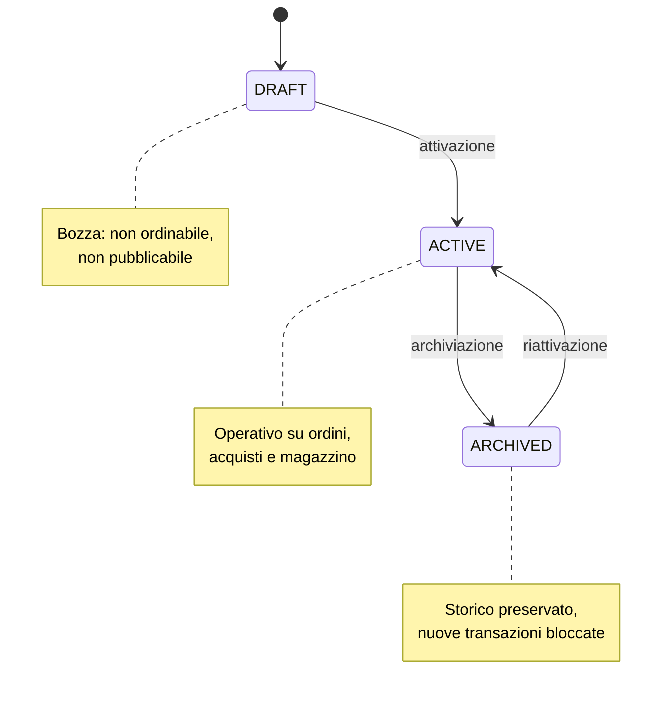
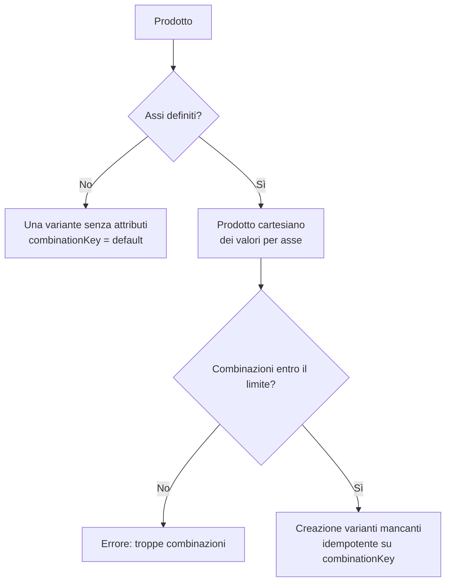
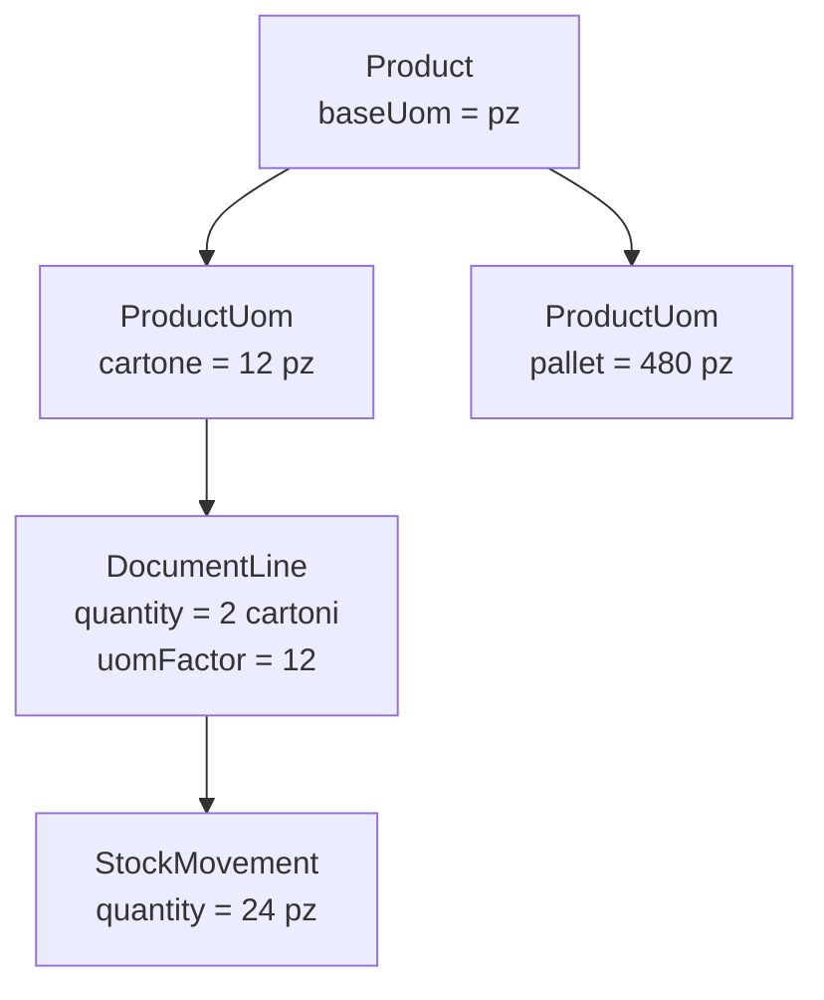
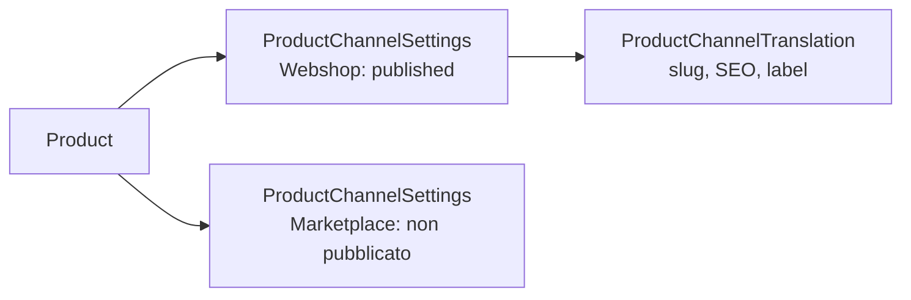
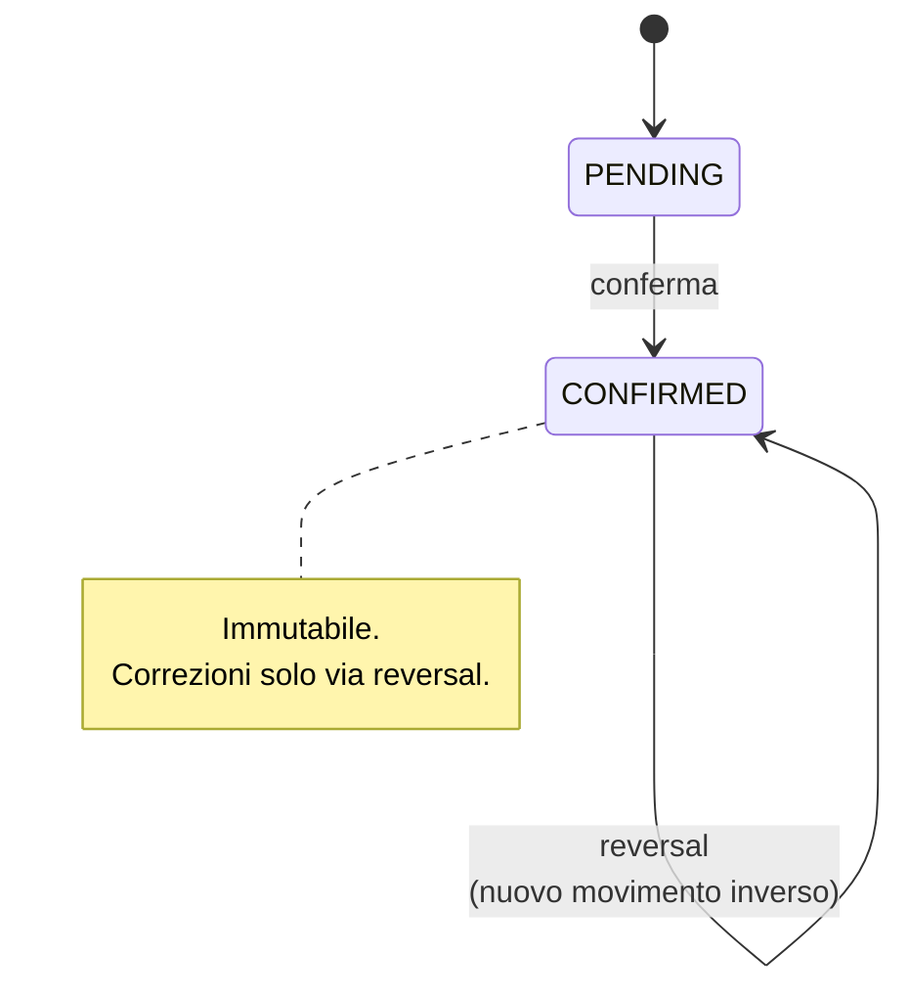
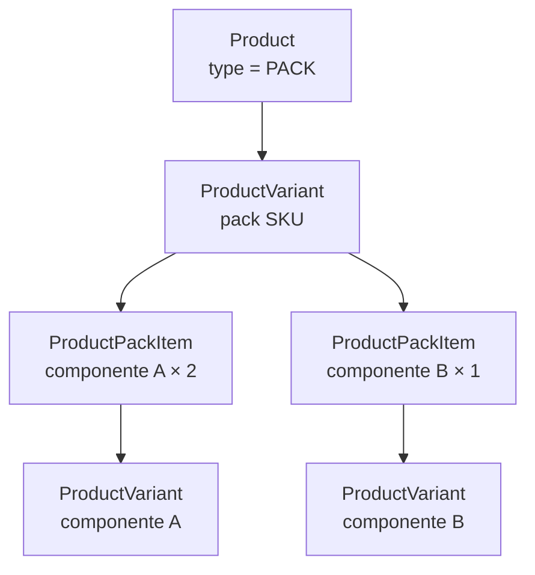
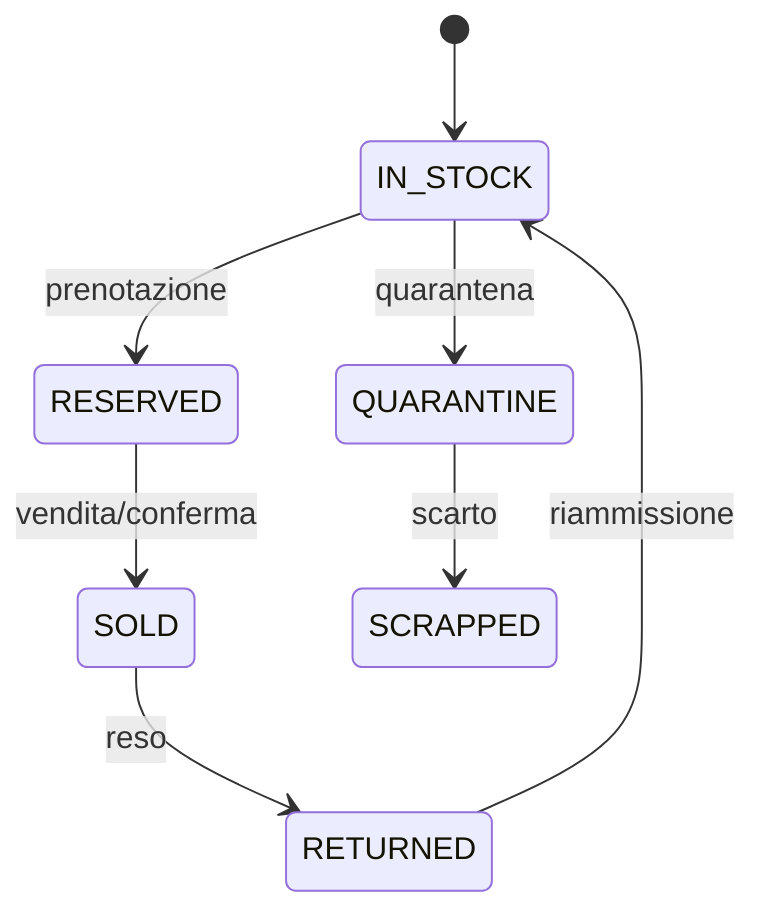

# Gestione Prodotti — Documentazione Concettuale

> Versione concettuale. Descrive il modello di dominio e le regole di business.
> I dettagli implementativi (campi, indici, FK) sono nello schema Prisma.

## 1. Panoramica

Il catalogo prodotti segue un modello **Master–Variant**:

- **Product** (master): l'entità commerciale "ombrello". Rappresenta il prodotto
  come lo conosce il mercato (es. "T-shirt Basic").
- **ProductVariant** (SKU): l'unità transazionale concreta. È ciò che si vende,
  si acquista, si movimenta e si prezza (es. "T-shirt Basic / Rosso / M").

Ogni prodotto, anche il più semplice, ha **almeno una variante**. I prodotti semplici possiedono un'unica variante senza attributi, identificata da `combinationKey = "default"`, mentre i prodotti variabili possiedono una o più varianti identificate dalle rispettive combinazioni di attributi.

Stock, listini, righe documento e movimenti puntano sempre alla variante, mai direttamente al master.

### Perché questa separazione

| Aspetto                      | Product (master)                   | ProductVariant (SKU)                   |
| ---------------------------- | ---------------------------------- | -------------------------------------- |
| Identità commerciale         | Sì (nome, descrizione, categoria)  | No                                     |
| Codice interno               | `reference`                        | `sku`                                  |
| Attributi di variante        | No (li definisce come assi)        | Sì (un valore per asse)                |
| Prezzo di vendita            | No (single source = PriceListItem) | No (eredita dal listino)               |
| Giacenza / movimenti         | No                                 | Sì                                     |
| Fornitori e costi d'acquisto | No                                 | Sì (via ProductSupplier)               |
| Pubblicazione su canali      | No                                 | No (gestito da ProductChannelSettings) |

## 2. Ciclo di vita del prodotto

Regole:

- Il passaggio ad `ARCHIVED` non elimina nulla: movimenti, righe documento e
  listini restano intatti (FK con `Restrict`).
- Il soft-delete (`deletedAt`) è separato dallo status: serve per la rimozione
  logica dall'interfaccia, non per il ciclo commerciale.
- Un prodotto `ARCHIVED` non può tornare `DRAFT`; può solo essere riattivato.

## 3. Varianti e attributi

### Assi di variante

Un **asse** è un gruppo di attributi lungo cui il prodotto varia (es. Colore, Taglia). Un prodotto dichiara i propri assi tramite `ProductVariantAxis`; ogni variante deve avere **esattamente un valore per ogni asse** dichiarato.

- **Prodotto semplice**: zero assi e una sola variante senza attributi, con `combinationKey = "default"`.
- **Prodotto variabile**: almeno un asse e una o più varianti, ciascuna con esattamente un valore per ogni asse dichiarato.
- **Numero di assi**: 1–3 assi consigliati; oltre questo numero la gestione delle combinazioni diventa potenzialmente complessa.
- **Numero di varianti**: almeno una variante valida per ogni prodotto.

### Generazione varianti

Regole:

- La generazione è **idempotente**: rieseguire il processo non crea duplicati (verifica su `combinationKey` esistente).
- Ogni prodotto deve avere almeno una variante valida.
- Il limite massimo consigliato è di 100 varianti per generazione.
- L'aggiunta di un nuovo valore a un asse esistente genera solo le combinazioni mancanti.
- La rimozione di un asse o di un valore non cancella le varianti esistenti. Le varianti non ancora utilizzate possono essere archiviate; quelle già referenziate da movimenti o documenti devono essere preservate per garantire l'integrità dello storico.
- Gli assi e i relativi attributi utilizzati da varianti storicamente referenziate non possono essere eliminati fisicamente.
- Se una combinazione già esistente e archiviata viene nuovamente generata, la variante viene riattivata anziché crearne una nuova.
- La variante di un prodotto semplice utilizza sempre `combinationKey = "default"` e non possiede attributi.

### Attributi vs assi

- **Asse (`ProductVariantAxis`)**: definisce _come_ il prodotto varia.
- **Attributo (`ProductVariantAttribute`)**: il valore concreto di un asse su una variante.
- Un attributo non può esistere su una variante se il suo gruppo non è un asse del prodotto.

## 4. Unità di misura

Ogni prodotto ha una **UoM base** (`baseUomId`), immutabile una volta che
esistono movimenti. Tutte le quantità di stock, listino e documento sono
espresse in questa unità.

### Tipi di conversione

| Tipo               | Dove vive              | Esempio                          |
| ------------------ | ---------------------- | -------------------------------- |
| Universale         | `UnitOfMeasure.factor` | 1 kg = 1000 g (stessa categoria) |
| Specifica prodotto | `ProductUom.factor`    | 1 cartone = 12 pz                |

Regole:

- Le conversioni universali valgono solo dentro la stessa `UomCategory`.
- Le UoM di tipo `PACKAGING` (cartone, pallet) non hanno fattore universale:
  passano sempre da `ProductUom`.
- `DocumentLine` memorizza `uomFactor` come snapshot: la quantità di stock è
  `quantity × uomFactor`, calcolata alla creazione della riga e mai ricalcolata.

## 5. Fornitori e acquisto

Il costo d'acquisto non vive sul prodotto né sulla variante: vive su
`ProductSupplier`, che lega variante e fornitore.

Ogni riga contiene:

- `supplierSku`: codice articolo presso il fornitore.
- `purchasePrice` + `currencyCode`: prezzo nella valuta del fornitore.
- `minOrderQty`, `leadTimeDays`: condizioni commerciali.
- `isPreferred`: al massimo un fornitore preferito per variante.

Il "fornitore predefinito" non è un campo sul prodotto: si legge da
`ProductSupplier` con `isPreferred = true`.

## 6. Prezzi

**Single source of truth: `PriceListItem`.**

- Il prezzo di vendita vive nel listino (`PriceList` → `PriceListItem`), con scaglioni
  di quantità, validità temporale e sconto proposto.
- `Product` e `ProductVariant` non hanno campi prezzo.
- Il prezzo d'acquisto non è un listino: vive in `ProductSupplier`.
- Tipi di listino: `SALE`, `PROMOTION`, `CONTRACT`.
- Un listino non converte valuta: documento, listino e listino padre hanno la stessa valuta.

### Unità di misura dei prezzi

`PriceListItem.price` e `minQuantity` sono espressi nella UoM base del prodotto.
Sulla riga documento: `unitPrice = price × uomFactor`; lo scaglione si confronta con
`quantity × uomFactor`.

### Scelta del listino

Un solo listino effettivo per documento, in quest'ordine:

1. listino impostato sul documento;
2. listino assegnato al cliente;
3. listino predefinito del tenant per la valuta del documento (`isDefault`).

### Risoluzione del prezzo

1. Voci della variante valide alla data (`validFrom`/`validTo`, estremi inclusi) con
   `minQuantity` ≤ quantità in UoM base.
2. Vince lo scaglione più alto; a parità, la voce con validità datata su quella senza data.
3. Senza voce, se il listino ha un padre: si risolve nel padre e si applica `strategy`
   (profondità massima 5). Una voce propria del listino derivato ha sempre la precedenza
   e non subisce la strategia.
4. L'arrotondamento (`roundingMethod`) si applica una sola volta, sul risultato finale.
   `NEAREST_05`/`NEAREST_10` arrotondano al multiplo più vicino, con criterio HALF_UP; `ROUND_UP`/`ROUND_DOWN`
   alla precisione monetaria.
5. Nessun prezzo → la riga non può essere confermata.

Le finestre di validità delle voci con la stessa variante e lo stesso scaglione non
possono sovrapporsi. `validTo` richiede `validFrom`.

### Sconto e override

- `PriceListItem.discountPercent` non cambia `unitPrice`: viene proposto come sconto della riga.
- Il prezzo applicato su una riga documento è uno snapshot (`unitPrice`, `originalUnitPrice`,
  `priceOverrideReason`). Se `unitPrice` è diverso dal prezzo risolto, `originalUnitPrice`
  conserva il prezzo di listino e `priceOverrideReason` è obbligatorio.

### Precisione e arrotondamento

- `PriceListItem.price` e `DocumentLine.unitPrice` sono a 6 decimali: preservano
  prezzi millesimali e conversioni di UoM.
- `DocumentLine.lineTotal`, `taxAmount` e tutti i totali documento sono a 2 decimali.
- `lineTotal = (unitPrice × quantity) − discountAmount`, arrotondato alla centesima.
- I totali documento sono la somma dei `lineTotal` e dei `taxAmount` già arrotondati.
- L'arrotondamento del listino (`roundingMethod`) si applica al prezzo base, una sola
  volta, al prezzo finale di un listino derivato. Le voci `EXPLICIT` non vengono mai
  arrotondate.
- `NEAREST_05`: multiplo più vicino di 0,05. `NEAREST_10`: multiplo più vicino di 0,10
- `ROUND_UP` / `ROUND_DOWN`: per eccesso / per difetto alla precisione monetaria.

## 7. Canali di vendita

Un **canale** (`SalesChannel`) è un punto di vendita (webshop, marketplace,
portale B2B, POS). La pubblicazione di un prodotto su un canale è gestita da
`ProductChannelSettings`:

- **Nessuna riga = prodotto non pubblicato su quel canale.**
- `isPublished`, `visibility`, `showPrice`, `onSale` sono per-canale.
- Contenuti SEO, slug, tag e label di disponibilità sono per-canale e per-lingua
  (`ProductChannelTranslation`).
- Redirect su disattivazione (`redirectType`, `redirectTargetId`) è per-canale.

Il master `Product` resta channel-agnostic: contiene solo dati ERP
(condizione, ecotax, codice doganale, UoM base).

## 8. Magazzino e stock

### Principi

- **Ledger append-only**: `StockMovement` è la fonte di verità. Un movimento
  confermato non si modifica né si cancella.
- **Stati**: `PENDING` (bozza, modificabile) → `CONFIRMED` (immutabile).
- **Correzioni**: sempre tramite movimento inverso (`reversedByMovementId`),
  mai tramite cancellazione o modifica.
- **Quantità**: sempre espresse nella UoM base del prodotto della variante.

### Tipi di giacenza

| Modello            | Scopo                                      | Natura                      |
| ------------------ | ------------------------------------------ | --------------------------- |
| `StockMovement`    | Ledger delle movimentazioni                | Append-only                 |
| `StockBatch`       | Saldo per lotto (scadenza, tracciabilità)  | Cache ricalcolabile         |
| `StockReservation` | Quantità bloccata per un documento         | Effimera                    |
| `VirtualStock`     | Disponibilità fornita da fornitore esterno | Snapshot sincronizzato      |
| `StockSerial`      | Tracciamento unità serializzata (IMEI, SN) | Anagrafica di ciclo di vita |

### Pack

Un `Product` di tipo `PACK` aggrega più varianti componente tramite
`ProductPackItem`. La strategia di scarico (`packStockType`) determina se
muovere solo il pack, solo i componenti, o entrambi.

Regole:

- I componenti sono **varianti**, non prodotti (lo stock è per SKU).
- I cicli (pack dentro pack) sono vietati o gestiti con limite di profondità.
- La vendita di un pack genera righe documento figlie per i componenti
  (`DocumentLine.parentLineId`), così lo storico non dipende dalla configurazione attuale.

### Seriali

Un `StockSerial` traccia una singola unità fisica attraverso il suo ciclo di vita.

- Unico per `(tenantId, productVariantId, serialNumber)`.
- Collegato all'ultimo movimento che lo ha toccato (`lastMovementId`).
- Se riservato, punta alla `StockReservation` attiva.

## 9. Invarianti

### Prodotti, varianti e attributi

- Ogni prodotto deve avere almeno una variante non archiviata.
- Un prodotto semplice non dichiara assi e possiede una sola variante senza attributi, identificata da `combinationKey = "default"`.
- Un prodotto variabile dichiara almeno un asse. Ogni variante non archiviata deve avere esattamente un valore per ciascun asse dichiarato e nessun valore appartenente ad assi non dichiarati.
- Le varianti archiviate possono conservare combinazioni di attributi non più coerenti con la configurazione corrente del prodotto, esclusivamente per preservare lo storico.
- La `combinationKey` deve essere deterministica e univoca nell'ambito della coppia `(tenantId, productId)`.
- Una variante utilizzata in transazioni non può essere eliminata fisicamente né modificata nella propria combinazione di attributi.
- Gli assi e i valori utilizzati da varianti referenziate nello storico non possono essere eliminati fisicamente.
- Un prodotto non può essere convertito liberamente da semplice a variabile o viceversa dopo la creazione di movimenti sulle sue varianti.

### Unità di misura

- Ogni prodotto deve avere un'unità di misura base.
- L'unità di misura base non può essere modificata dopo la creazione di movimenti di magazzino.
- Le conversioni specifiche del prodotto devono essere definite attraverso i relativi fattori di conversione.
- Il fattore di conversione utilizzato in una riga documento deve essere salvato come snapshot (`uomFactor`), in modo da preservare il significato della quantità anche in caso di successive modifiche alle conversioni.

### Fornitori e approvvigionamento

- L'associazione tra prodotto e fornitore deve essere definita a livello di variante (`ProductSupplier`).
- Per ogni variante può esistere al massimo un fornitore preferito.
- I prezzi e le condizioni di acquisto utilizzati nei documenti devono essere preservati nello storico e non devono dipendere dai successivi aggiornamenti dell'anagrafica del fornitore.

### Prezzi e listini

- `PriceListItem` rappresenta l'unica fonte di configurazione dei prezzi dei listini.
- La risoluzione del prezzo deve rispettare l'ordine di priorità e le regole di ereditarietà definite nella sezione 6.
- Gli arrotondamenti devono essere applicati secondo il metodo configurato nel listino:
  - `NEAREST_05` e `NEAREST_10`: arrotondamento al multiplo più vicino, con metodo `HALF_UP`.
  - `ROUND_UP` e `ROUND_DOWN`: arrotondamento rispettivamente per eccesso e per difetto alla precisione monetaria configurata.
- L'arrotondamento del listino deve essere applicato una sola volta al prezzo risultante dalla risoluzione, non cumulativamente durante i passaggi di ereditarietà.
- L'arrotondamento del listino non si applica alle voci esplicite.

### Magazzino e movimenti

- Il registro dei movimenti di magazzino (`StockMovement`) è append-only: i movimenti registrati non possono essere modificati o eliminati fisicamente.
- Le correzioni di movimenti già registrati devono avvenire attraverso movimenti inversi o rettificativi, mantenendo il riferimento al movimento originale.
- Un movimento non può essere stornato più di una volta, salvo il caso di storni parziali esplicitamente supportati.
- La registrazione di un movimento e l'eventuale aggiornamento delle relative proiezioni di stock devono avvenire in modo atomico.
- I saldi e le disponibilità derivate dai movimenti devono poter essere ricostruiti a partire dal registro delle operazioni.

### Documenti e storico

- Le righe dei documenti devono conservare gli snapshot dei dati necessari a ricostruire le condizioni applicate al momento della registrazione, indipendentemente dalle successive modifiche alle anagrafiche, ai listini e alle configurazioni.
- Le operazioni storiche devono mantenere i riferimenti alle varianti e alle informazioni necessarie a interpretarne correttamente il significato nel tempo.

### Canali di vendita

- Le impostazioni di pubblicazione e disponibilità sui canali (`ProductChannelSettings`) sono associate al prodotto master.
- Le configurazioni specifiche di un canale non devono modificare i dati anagrafici o le condizioni commerciali degli altri canali.

## 10. Glossario

| Termine           | Definizione                                                  |
| ----------------- | ------------------------------------------------------------ |
| Master / Template | `Product`: entità commerciale ombrello                       |
| SKU / Variant     | `ProductVariant`: unità transazionale concreta               |
| Asse              | Gruppo di attributi lungo cui il prodotto varia              |
| Combinazione      | Insieme di valori (uno per asse) che identifica una variante |
| UoM base          | Unità di misura di riferimento per stock e listini           |
| Pack              | Prodotto composto da più varianti componente                 |
| Ledger            | Registro append-only delle movimentazioni (`StockMovement`)  |
| Canale            | Punto di vendita (webshop, marketplace, POS)                 |
| Snapshot          | Copia immutabile di un dato al momento della transazione     |
