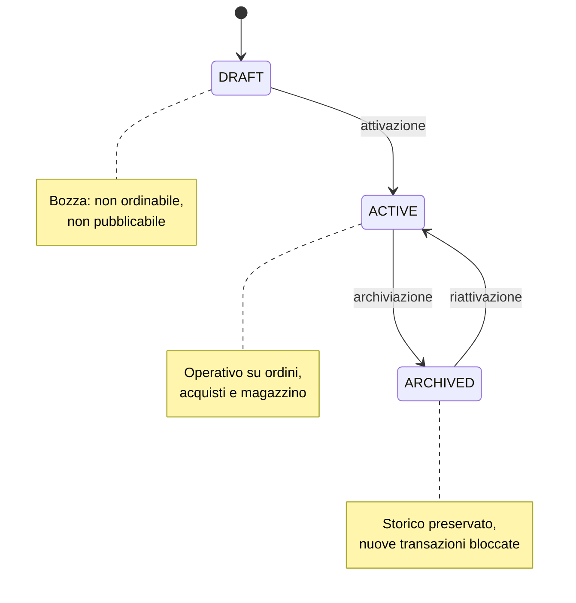
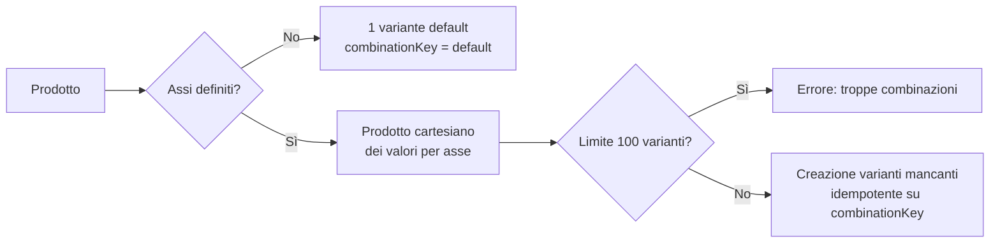
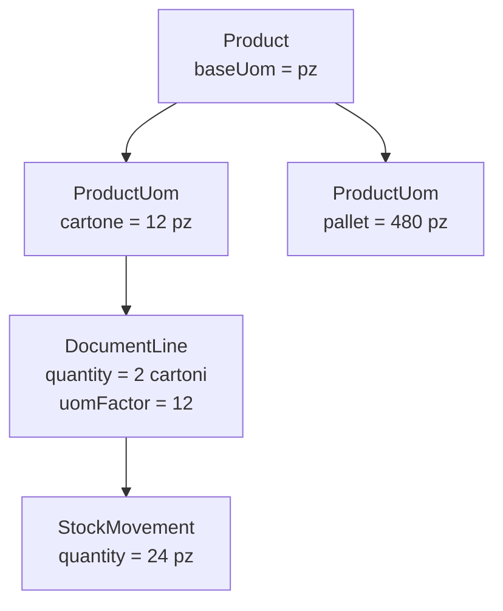
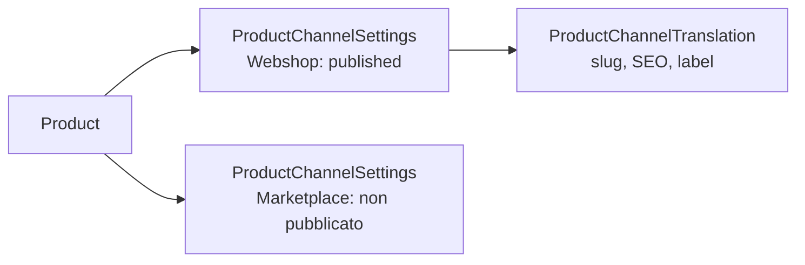
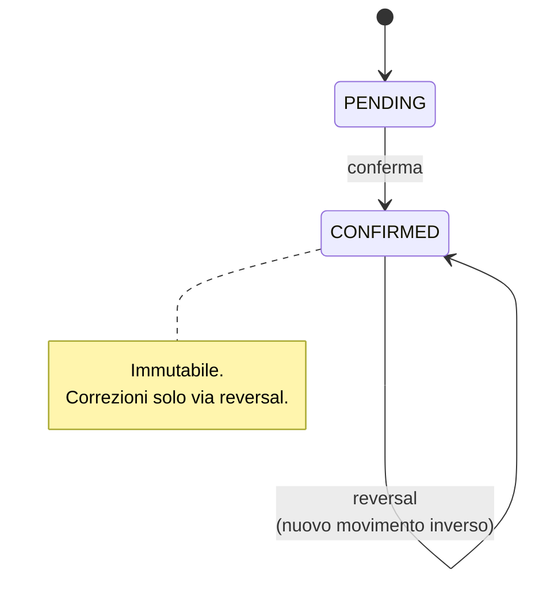
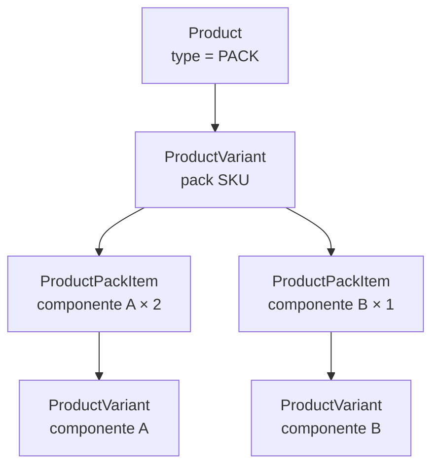
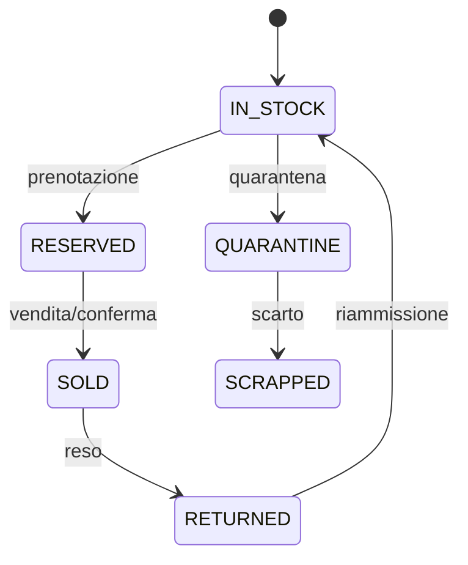

# Gestione Prodotti — Documentazione Concettuale

> Versione concettuale. Descrive il modello di dominio e le regole di business.
> I dettagli implementativi (campi, indici, FK) sono nello schema Prisma.

## 1. Panoramica

Il catalogo prodotti segue un modello **Master–Variant**:

- **Product** (master): l'entità commerciale "ombrello". Rappresenta il prodotto
  come lo conosce il mercato (es. "T-shirt Basic").
- **ProductVariant** (SKU): l'unità transazionale concreta. È ciò che si vende,
  si acquista, si movimenta e si prezza (es. "T-shirt Basic / Rosso / M").

Ogni prodotto, anche il più semplice, ha **almeno una variante di default**
senza attributi. Stock, listini, righe documento e movimenti puntano sempre
alla variante, mai direttamente al master.

### Perché questa separazione

| Aspetto | Product (master) | ProductVariant (SKU) |
|---|---|---|
| Identità commerciale | Sì (nome, descrizione, categoria) | No |
| Codice interno | `reference` | `sku` |
| Attributi di variante | No (li definisce come assi) | Sì (un valore per asse) |
| Prezzo di vendita | No (single source = PriceListItem) | No (eredita dal listino) |
| Giacenza / movimenti | No | Sì |
| Fornitori e costi d'acquisto | No | Sì (via ProductSupplier) |
| Pubblicazione su canali | No | No (gestito da ProductChannelSettings) |

## 2. Ciclo di vita del prodotto

Regole:
- Il passaggio ad `ARCHIVED` non elimina nulla: movimenti, righe documento e
  listini restano intatti (FK con `Restrict`).
- Il soft-delete (`deletedAt`) è separato dallo status: serve per la rimozione
  logica dall'interfaccia, non per il ciclo commerciale.
- Un prodotto `ARCHIVED` non può tornare `DRAFT`; può solo essere riattivato.

## 3. Varianti e attributi

### Assi di variante

Un **asse** è un gruppo di attributi lungo cui il prodotto varia
(es. Colore, Taglia). Un prodotto dichiara i propri assi tramite
`ProductVariantAxis`; ogni variante deve avere **esattamente un valore per
ogni asse** dichiarato.

- Prodotto semplice: zero assi, una variante `combinationKey = "default"`.
- Prodotto variabile: 1–3 assi consigliati (oltre diventa ingestibile).
- La combinazione è identificata da `combinationKey`, hash deterministico
  degli ID attributo ordinati. Garantisce l'unicità per prodotto.

### Generazione varianti

Regole:
- La generazione è **idempotente**: rieseguire non crea duplicati
  (verifica su `combinationKey` esistente).
- Limite massimo consigliato: 100 varianti per generazione.
- L'aggiunta di un nuovo valore a un asse esistente genera solo le combinazioni mancanti.
- La rimozione di un asse o di un valore non cancella le varianti esistenti:
  le archivia (soft-delete) se non hanno movimenti.

### Attributi vs assi

- **Asse (`ProductVariantAxis`)**: definisce *come* il prodotto varia.
- **Attributo (`ProductVariantAttribute`)**: il valore concreto di un asse su una variante.
- Un attributo non può esistere su una variante se il suo gruppo non è un asse del prodotto.

## 4. Unità di misura

Ogni prodotto ha una **UoM base** (`baseUomId`), immutabile una volta che
esistono movimenti. Tutte le quantità di stock, listino e documento sono
espresse in questa unità.

### Tipi di conversione

| Tipo | Dove vive | Esempio |
|---|---|---|
| Universale | `UnitOfMeasure.factor` | 1 kg = 1000 g (stessa categoria) |
| Specifica prodotto | `ProductUom.factor` | 1 cartone = 12 pz |

Regole:
- Le conversioni universali valgono solo dentro la stessa `UomCategory`.
- Le UoM di tipo `PACKAGING` (cartone, pallet) non hanno fattore universale:
  passano sempre da `ProductUom`.
- `DocumentLine` memorizza `uomFactor` come snapshot: la quantità di stock è
  `quantity × uomFactor`, calcolata alla creazione della riga e mai ricalcolata.

## 5. Fornitori e acquisto

Il costo d'acquisto non vive sul prodotto né sulla variante: vive su
`ProductSupplier`, che lega variante e fornitore.

Ogni riga contiene:
- `supplierSku`: codice articolo presso il fornitore.
- `purchasePrice` + `currencyCode`: prezzo nella valuta del fornitore.
- `minOrderQty`, `leadTimeDays`: condizioni commerciali.
- `isPreferred`: al massimo un fornitore preferito per variante.

Il "fornitore predefinito" non è un campo sul prodotto: si legge da
`ProductSupplier` con `isPreferred = true`.

## 6. Prezzi

**Single source of truth: `PriceListItem`.**

- Il prezzo di vendita vive nel listino (`PriceList` → `PriceListItem`), con scaglioni
  di quantità, validità temporale e sconto proposto.
- `Product` e `ProductVariant` non hanno campi prezzo.
- Il prezzo d'acquisto non è un listino: vive in `ProductSupplier`.
- Tipi di listino: `SALE`, `PROMOTION`, `CONTRACT`.
- Un listino non converte valuta: documento, listino e listino padre hanno la stessa valuta.

### Unità di misura dei prezzi
`PriceListItem.price` e `minQuantity` sono espressi nella UoM base del prodotto.
Sulla riga documento: `unitPrice = price × uomFactor`; lo scaglione si confronta con
`quantity × uomFactor`.

### Scelta del listino
Un solo listino effettivo per documento, in quest'ordine:
1. listino impostato sul documento;
2. listino assegnato al cliente;
3. listino predefinito del tenant per la valuta del documento (`isDefault`).

### Risoluzione del prezzo
1. Voci della variante valide alla data (`validFrom`/`validTo`, estremi inclusi) con
   `minQuantity` ≤ quantità in UoM base.
2. Vince lo scaglione più alto; a parità, la voce con validità datata su quella senza data.
3. Senza voce, se il listino ha un padre: si risolve nel padre e si applica `strategy`
   (profondità massima 5). Una voce propria del listino derivato ha sempre la precedenza
   e non subisce la strategia.
4. L'arrotondamento (`roundingMethod`) si applica una sola volta, sul risultato finale.
   `NEAREST_05`/`NEAREST_10` arrotondano al multiplo più vicino; `ROUND_UP`/`ROUND_DOWN`
   all'unità intera di valuta.
5. Nessun prezzo → la riga non può essere confermata.

Le finestre di validità delle voci con la stessa variante e lo stesso scaglione non
possono sovrapporsi. `validTo` richiede `validFrom`.

### Sconto e override
- `PriceListItem.discountPercent` non cambia `unitPrice`: viene proposto come sconto della riga.
- Il prezzo applicato su una riga documento è uno snapshot (`unitPrice`, `originalUnitPrice`,
  `priceOverrideReason`). Se `unitPrice` è diverso dal prezzo risolto, `originalUnitPrice`
  conserva il prezzo di listino e `priceOverrideReason` è obbligatorio.

### Precisione e arrotondamento
- `PriceListItem.price` e `DocumentLine.unitPrice` sono a 6 decimali: preservano
  prezzi millesimali e conversioni di UoM.
- `DocumentLine.lineTotal`, `taxAmount` e tutti i totali documento sono a 2 decimali.
- `lineTotal = (unitPrice × quantity) − discountAmount`, arrotondato alla centesima.
- I totali documento sono la somma dei `lineTotal` e dei `taxAmount` già arrotondati.
- L'arrotondamento del listino (`roundingMethod`) si applica al prezzo base, una sola
  volta, al prezzo finale di un listino derivato. Le voci `EXPLICIT` non vengono mai
  arrotondate.
- `NEAREST_05`: multiplo più vicino di 0,05. `NEAREST_10`: multiplo più vicino di 0,10.
- `ROUND_UP` / `ROUND_DOWN`: per eccesso / per difetto alla sesta cifra decimale.

## 7. Canali di vendita

Un **canale** (`SalesChannel`) è un punto di vendita (webshop, marketplace,
portale B2B, POS). La pubblicazione di un prodotto su un canale è gestita da
`ProductChannelSettings`:

- **Nessuna riga = prodotto non pubblicato su quel canale.**
- `isPublished`, `visibility`, `showPrice`, `onSale` sono per-canale.
- Contenuti SEO, slug, tag e label di disponibilità sono per-canale e per-lingua
  (`ProductChannelTranslation`).
- Redirect su disattivazione (`redirectType`, `redirectTargetId`) è per-canale.

Il master `Product` resta channel-agnostic: contiene solo dati ERP
(condizione, ecotax, codice doganale, UoM base).

## 8. Magazzino e stock

### Principi

- **Ledger append-only**: `StockMovement` è la fonte di verità. Un movimento
  confermato non si modifica né si cancella.
- **Stati**: `PENDING` (bozza, modificabile) → `CONFIRMED` (immutabile).
- **Correzioni**: sempre tramite movimento inverso (`reversedByMovementId`),
  mai tramite cancellazione o modifica.
- **Quantità**: sempre espresse nella UoM base del prodotto della variante.

### Tipi di giacenza

| Modello | Scopo | Natura |
|---|---|---|
| `StockMovement` | Ledger delle movimentazioni | Append-only |
| `StockBatch` | Saldo per lotto (scadenza, tracciabilità) | Cache ricalcolabile |
| `StockReservation` | Quantità bloccata per un documento | Effimera |
| `VirtualStock` | Disponibilità fornita da fornitore esterno | Snapshot sincronizzato |
| `StockSerial` | Tracciamento unità serializzata (IMEI, SN) | Anagrafica di ciclo di vita |

### Pack

Un `Product` di tipo `PACK` aggrega più varianti componente tramite
`ProductPackItem`. La strategia di scarico (`packStockType`) determina se
muovere solo il pack, solo i componenti, o entrambi.

Regole:
- I componenti sono **varianti**, non prodotti (lo stock è per SKU).
- I cicli (pack dentro pack) sono vietati o gestiti con limite di profondità.
- La vendita di un pack genera righe documento figlie per i componenti
  (`DocumentLine.parentLineId`), così lo storico non dipende dalla configurazione attuale.

### Seriali

Un `StockSerial` traccia una singola unità fisica attraverso il suo ciclo di vita.

- Unico per `(tenantId, productVariantId, serialNumber)`.
- Collegato all'ultimo movimento che lo ha toccato (`lastMovementId`).
- Se riservato, punta alla `StockReservation` attiva.

## 9. Invarianti e regole trasversali

- Ogni prodotto ha almeno una variante di default.
- Ogni variante ha esattamente un valore per ogni asse del prodotto.
- `combinationKey` è unico per `(tenantId, productId)`.
- `baseUomId` è immutabile se esistono movimenti.
- Le quantità di stock sono sempre nella UoM base.
- Il prezzo di vendita vive solo nei listini; il prezzo d'acquisto solo in `ProductSupplier`.
- La pubblicazione su canale è esplicita (assenza di riga = non pubblicato).
- I movimenti confermati sono immutabili; le correzioni passano da reversal.
- Ogni documento conserva snapshot di prezzi, tasse, UoM e descrizioni:
  il catalogo può cambiare, lo storico no.
- I prezzi unitari sono a 6 decimali; i totali di riga e documento a 2 decimali.
- L'arrotondamento del listino non si applica alle voci esplicite

## 10. Glossario

| Termine | Definizione |
|---|---|
| Master / Template | `Product`: entità commerciale ombrello |
| SKU / Variant | `ProductVariant`: unità transazionale concreta |
| Asse | Gruppo di attributi lungo cui il prodotto varia |
| Combinazione | Insieme di valori (uno per asse) che identifica una variante |
| UoM base | Unità di misura di riferimento per stock e listini |
| Pack | Prodotto composto da più varianti componente |
| Ledger | Registro append-only delle movimentazioni (`StockMovement`) |
| Canale | Punto di vendita (webshop, marketplace, POS) |
| Snapshot | Copia immutabile di un dato al momento della transazione |
